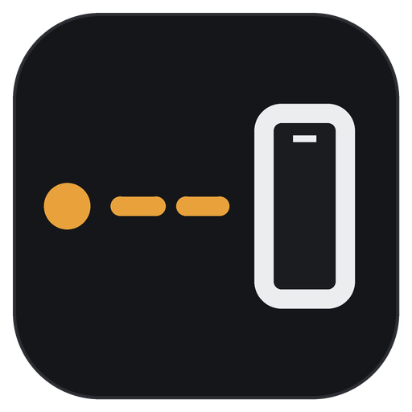
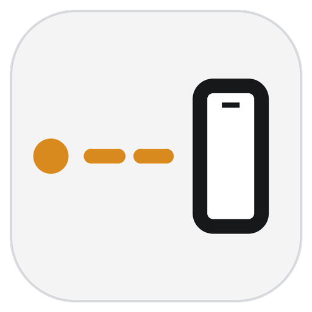

# ADB File Transfer

<p>
  
  
</p>

A small Windows app for moving files between your PC and an Android phone over USB or Wi-Fi, using `adb`. It has a dark and a light theme.

## Download

Get `ADBFileTransfer.exe` from the [latest release](../../releases/tag/latest). It is rebuilt on every push to `main`.

You can also open the **Actions** tab, pick the newest "Build Windows exe" run, and download the `ADBFileTransfer` artifact. Pushing a tag like `v1.0.0` publishes the exe to a numbered release.

## What you can do

**To phone.** Add files or whole folders (or drop them on the window), pick a folder on the phone, and press **Send to phone**. You see live progress, speed and a tick or error for every item.

**From phone.** Browse the phone's storage, click files or folders to select them, choose a folder on the PC, and press **Save to PC**. Double-click a folder, or click its arrow, to open it.

**Install apps.** Add `.apk` files or a folder of them and press **Install on phone**. Bundles (`.apks`, `.xapk`, `.apkm`) are unpacked and installed as split APKs, and `.xapk` game data is copied to the phone. Options:

- Replace if already installed (on by default)
- Grant all permissions
- Allow older versions
- Allow test builds
- Combine into one app, for split APKs added together

If an install fails, the reason is shown on that app's row, with what to change.

**Connect.** Use a USB cable, or go wireless:

- **Scan QR**: on the phone open Settings > Developer options > Wireless debugging > *Pair device with QR code* and scan the code. The app pairs and connects. Phone and PC must be on the same Wi-Fi.
- **Pair with code**: use this if the QR code isn't found. Enter the pairing address and code shown on the phone.
- **Wi-Fi address**: connect straight to an `ip:port` you've already paired.

**Theme.** The sun and moon button in the top-right corner switches between dark and light. The app starts in your Windows theme and remembers your choice.

## Set up

1. Install Android platform-tools (`adb`). Put it on PATH, next to `ADBFileTransfer.exe`, in a `platform-tools` folder next to it, or use **Change** in the app to pick `adb.exe`.
2. On the phone, turn on Developer options and USB debugging, then accept the prompt when you plug in.

If the phone isn't found, check the USB cable (it must carry data), set the USB mode to File transfer, and press **Refresh**. If adb behaves oddly, run `adb kill-server` and then `adb start-server`.

## Run from source

```
pip install -r requirements.txt
python adb_transfer.py
```

Needs Python 3.8+ with tkinter. `qrcode` enables QR pairing and `windnd` enables drag and drop on Windows. The .exe already includes both.

## Build the .exe yourself

Double-click `build_exe.bat`, or run:

```
pip install --upgrade pyinstaller qrcode windnd
python -m PyInstaller --onefile --noconsole --icon assets/icon-dark.ico --name ADBFileTransfer adb_transfer.py
```

The result is `dist/ADBFileTransfer.exe`.

## Icons

`assets/make_icons.py` draws the dark and light icons (needs Pillow). The window and taskbar icon follow your Windows theme. The .exe file uses the dark icon.
